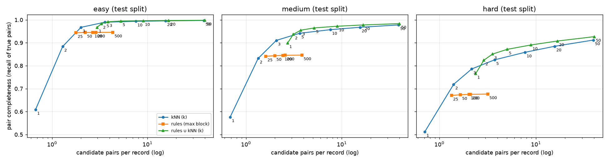

# Milestone 2 — blocking

Encoder `intfloat/multilingual-e5-small` (text: name_clean, city_norm); rules {'pin_first': ['pin_norm', 'first_token'], 'phonetic': ['name_phonetic'], 'first_city': ['first_token', 'city_norm'], 'key_exact': ['name_key']} with max block size 200; kNN k=10. Evaluated on the **test** split (entity-disjoint).

| level | method | param | pairs | pairs_per_record | pair_completeness | reduction_ratio | pair_quality |
|---|---|---|---|---|---|---|---|
| easy | rule:pin_first | 200 | 77328 | 0.769 | 0.6279 | 0.999985 | 0.7883 |
| easy | rule:phonetic | 200 | 106566 | 1.0597 | 0.8885 | 0.999979 | 0.8094 |
| easy | rule:first_city | 200 | 259490 | 2.5805 | 0.8823 | 0.999949 | 0.3301 |
| easy | rule:key_exact | 200 | 78140 | 0.7771 | 0.804 | 0.999985 | 0.9989 |
| easy | rules | 200 | 289332 | 2.8773 | 0.9453 | 0.999943 | 0.3172 |
| easy | knn | 10 | 757621 | 7.5342 | 0.9934 | 0.999850 | 0.1273 |
| easy | union | rules+knn10 | 907373 | 9.0234 | 0.9961 | 0.999821 | 0.1066 |
| medium | rule:pin_first | 200 | 55452 | 0.5514 | 0.4432 | 0.999989 | 0.7758 |
| medium | rule:phonetic | 200 | 88010 | 0.8752 | 0.73 | 0.999983 | 0.8052 |
| medium | rule:first_city | 200 | 227285 | 2.2602 | 0.7397 | 0.999955 | 0.3159 |
| medium | rule:key_exact | 200 | 57428 | 0.5711 | 0.5907 | 0.999989 | 0.9985 |
| medium | rules | 200 | 257607 | 2.5618 | 0.8455 | 0.999949 | 0.3186 |
| medium | knn | 10 | 764689 | 7.6045 | 0.9571 | 0.999849 | 0.1215 |
| medium | union | rules+knn10 | 902380 | 8.9737 | 0.9721 | 0.999822 | 0.1046 |
| hard | rule:pin_first | 200 | 33932 | 0.3374 | 0.2676 | 0.999993 | 0.7656 |
| hard | rule:phonetic | 200 | 66533 | 0.6616 | 0.5417 | 0.999987 | 0.7904 |
| hard | rule:first_city | 200 | 184902 | 1.8388 | 0.5676 | 0.999963 | 0.298 |
| hard | rule:key_exact | 200 | 40162 | 0.3994 | 0.4132 | 0.999992 | 0.9988 |
| hard | rules | 200 | 211049 | 2.0988 | 0.6753 | 0.999958 | 0.3106 |
| hard | knn | 10 | 773801 | 7.6951 | 0.8584 | 0.999847 | 0.1077 |
| hard | union | rules+knn10 | 891646 | 8.867 | 0.8904 | 0.999824 | 0.0969 |
